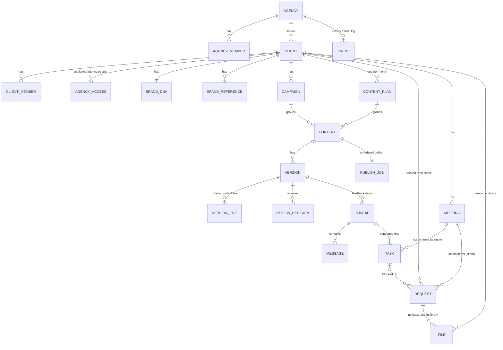
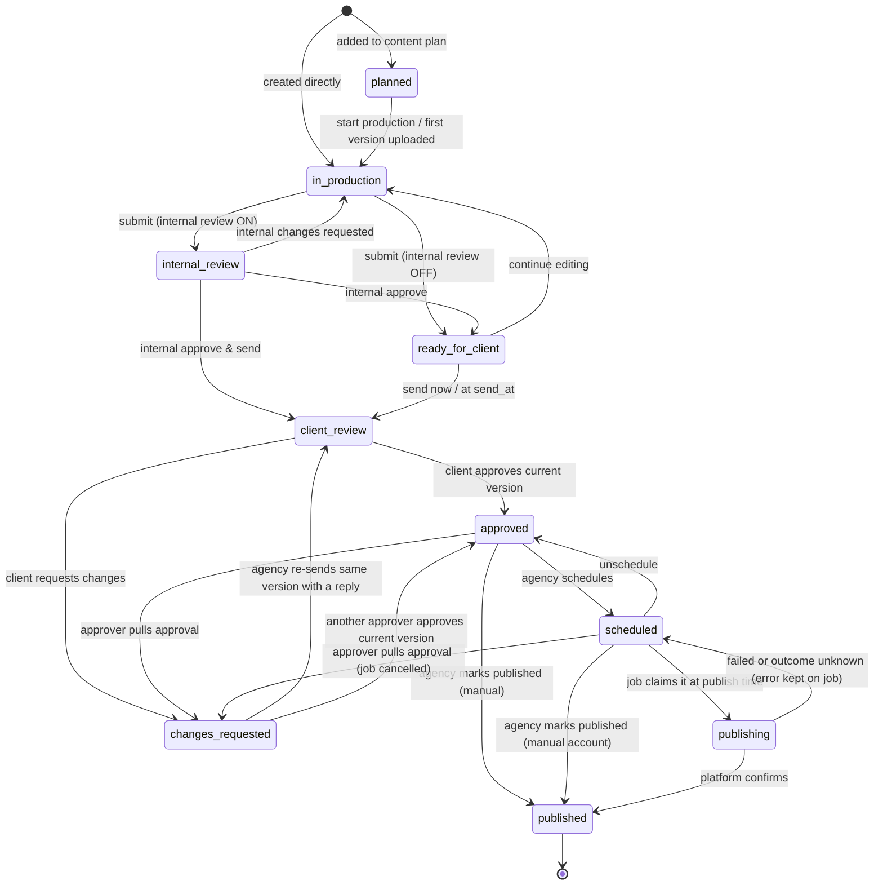

# Matcha — System Understanding & Design

> Source documents: `res/Matcha App.pdf` (Client App, features **F01–F90**) and `res/Matcha portal.pdf` (Agency Portal, features **P01–P177**).
> This file explains what Matcha is, how every part connects, and the final flows after fixing the flaws found in the spec.
> Every change against the spec — and every gap that had to be filled — is logged with a one-line reason in [DECISIONS.md](DECISIONS.md) (referenced below as **D01**, **D02** …).

---

## Contents

1. [What Matcha is](#1-what-matcha-is)
2. [Glossary (one word = one meaning)](#2-glossary)
3. [Who uses it — actors, roles, permissions](#3-who-uses-it)
4. [Tenancy — how agencies, clients and people are organised](#4-tenancy)
5. [Data model — the core objects and how they connect](#5-data-model)
6. [State machines — the single source of truth for every status](#6-state-machines)
7. [End-to-end flows](#7-end-to-end-flows)
8. [Client ↔ Agency connections (what each action triggers)](#8-client--agency-connections)
9. [Feature inventory — Client App](#9-feature-inventory--client-app)
10. [Feature inventory — Agency Portal](#10-feature-inventory--agency-portal)
11. [Answers to the 30 open questions in the spec](#11-answers-to-the-open-questions)
12. [System rules (security, concurrency, files, AI, time)](#12-system-rules)
13. [Build order](#13-build-order)
14. [Still genuinely open (business inputs needed)](#14-still-open)
15. [Where the current code stands vs this design](#15-current-code-vs-this-design)

---

## 1. What Matcha is

Matcha is a **collaboration system between a creative / marketing agency and its clients**. It replaces the WhatsApp + email + Drive + spreadsheet mess agencies use today to get social media content made, reviewed, approved and published.

It is **one system with two faces** sharing one backend and one database:

| | **Agency Portal** (web) | **Client App** (mobile-first — the spec says "client taps") |
|---|---|---|
| Who | Agency team (founder, account managers, designers, copywriters, social media managers …) | People at the client's company (founder, marketing lead, approver …) |
| Job | The **operational layer**: manage clients, plan, produce, review internally, send to client, process feedback, schedule/publish, report, manage team | The **transparency + decision layer**: understand the brand, see what the agency is doing, review creatives, give precise feedback, approve, provide what's needed, attend meetings |
| Sees | Everything (subject to role & client access) | Only what has been deliberately shared with the client |

### The goals Matcha must achieve

1. **Precise feedback.** Clients comment *on* the creative — pinned to a slide, a video timestamp, or a drawn annotation, or as a voice note — instead of vague WhatsApp messages.
2. **Clear approvals.** Approve or Request Changes on a *specific version*. No "like" button. Approval is recorded with who and when.
3. **Revision tracking.** Versions V01 → V02 → V03, with a visible revision count against the contract ("2 of 4 used").
4. **Nothing is lost.** Every piece of feedback becomes a trackable item (open → in progress → resolved) and can become a task.
5. **Clients always know what needs them.** One "Needs Attention" surface: things to review, things to upload, meetings.
6. **Brand memory.** Onboarding builds a **Brand DNA** (about, audience, tone, likes, dislikes, references, assets). It is the agency's permanent creative reference.
7. **Agency runs operations in one place.** Clients, campaigns, content plans, production, tasks, workload, calendar, meetings, publishing, analytics and reports.
8. **Internal stays internal.** Internal reviews, notes and AI interpretations never leak to the client. The only AI text a client ever sees is the plain transcript of a voice note, clearly labelled (D22).
9. **AI assists, humans decide.** AI turns messy feedback (voice, comments, annotations) into a checklist and suggested tasks. It summarises meetings and drafts insights. A human always confirms before anything becomes official.
10. **Calm, neutral client experience.** Delays are shown neutrally ("Schedule shifted · 1 day"), never as blame.

### The core loop (the heart of the product)

```
Agency plans → Agency produces V01 → (internal review) → Sent to client
   → Client reviews (comment / annotate / timestamp / voice)
        ├─ Request changes → feedback → AI checklist → tasks → V02 → back to client …
        └─ Approve (this exact version) → Agency schedules → Published → Analytics → Report
```

Everything else in Matcha supports this loop: onboarding feeds it context, requests feed it assets, meetings feed it decisions, and the calendar and notifications keep it moving.

---

## 2. Glossary

The spec uses "workspace" for three different things and "review/approval" interchangeably. These are the fixed meanings (**D62**):

| Term | Meaning |
|---|---|
| **Agency** | The tenant. One paying organisation using Matcha (spec: "agency workspace"). |
| **Client** | One brand the agency works for (spec: "client workspace"). Always exactly one brand (**D43**). |
| **Client space** | The client-facing area of one Client inside the Client App (spec F63 "Workspace" section). |
| **Member** | A person with access. *Agency member* or *client member*. One login can hold many memberships. |
| **Content** | One deliverable: a post, reel, carousel, story, etc. It lives from `planned` to `published`. |
| **Version** | An immutable snapshot of a content's creative files **plus caption** (V01, V02 …) (**D06**). |
| **Review round** | One version sent to the client for a decision. |
| **Feedback item** | One precise point of feedback on a version: text, voice or annotation, optionally anchored to a slide or timestamp. Has a status. |
| **Thread** | A conversation. A feedback item is a thread with an anchor and a status (**D17**). |
| **Revision** | A version the client requested changes on (**D09**). |
| **Request** | Something the agency needs *from* the client ("Needed From You"). |
| **Task** | Agency-internal unit of work. |
| **Content plan** | The set of content for one client and one month, sent to the client for alignment. |
| **Campaign** | A grouping of content with an objective, dates and a brief. |

---

## 3. Who uses it

### 3.1 Agency roles (permission levels) — **D44**

The spec's P133 list (Admin, Founder, Account Manager, Designer, Copywriter, SMM …) mixes **job titles** with **permissions**. Here they are separate:

- **Permission role** (one per person per agency) — decides what they *can do*.
- **Job title / department** (free tags, many allowed) — decides how they are *displayed and grouped* (workload by department, "assign to Designer").

| Role | Can do |
|---|---|
| **Owner** | Everything, including billing, deleting the agency and transferring ownership. Exactly one per agency. |
| **Admin** | Team, roles, all clients, integrations, workspace settings. Sees all clients. |
| **Manager** | On *assigned* clients: internal approval, send to client, manage client members, edit Brand DNA, campaigns, plans. Can create clients (and is auto-assigned to them). |
| **Member** | On *assigned* clients: create/edit content, upload versions, work tasks, reply to feedback, internal notes. |

There is no agency Viewer role (dropped 2026-11-04, see D44).

**One capability flag: `can_publish`** (always on for Owner/Admin; can be switched on for any Manager or Member). This lets a Social Media Manager publish without also getting internal approval or client management (**D25**). There is no other per-person permission — no permission matrix.

**Client access (P135):** Owner and Admin see every client. Everyone else sees only clients they are assigned to. A hidden client returns 404, as the server does today. **Effective permission = role ∩ client access** (**D45**).

### 3.2 Client roles — **D47**

| Role | Review & send feedback | Approve / Request changes | Upload to requests | Edit Brand DNA | Invite client colleagues |
|---|---|---|---|---|---|
| **Admin** (first invited person) | ✅ | ✅ | ✅ | ✅ | ✅ |
| **Approver** | ✅ | ✅ | ✅ | ✅ | — |
| **Contributor** | ✅ | — | ✅ | ✅ | — |
| **Viewer** | read only | — | — | — | — |

- Any Admin/Approver can approve. Any of them can also pull an approval until publishing starts. If two people act at once, the second gets "Priya approved this at 4:42 — still request changes?" and must confirm (**D07**).
- A client Admin can invite colleagues. The agency is notified and can revoke (**D48**).
- Agency Managers can also add or remove client members.
- **A client always has at least one Admin.** The last Admin can't be removed or downgraded, so there is always someone who can approve.
- The roles cover P173's permission areas. The only per-client switch is **"Show analytics to client"** (off until analytics is ready) (**D47**).

### 3.3 Visibility rule (non-negotiable) — **D20**

Every thread, message, feedback item, note, file and event has a `visibility`: **`client`** (shared) or **`internal`** (agency only).
Client users can *only ever* read `client` rows. This is enforced in the server's data-access layer, never only in the UI.

---

## 4. Tenancy

```
Login (person, 1 email)
 ├── Agency membership(s) ──► Agency A (role: Manager)        ← agency switcher if >1 (P04)
 │                              └── Clients: Velvet Oven, Aeronext …  (assigned via client access)
 └── Client membership(s) ──► Client "Velvet Oven" (role: Approver)   ← brand switcher if >1
                              └── Client "Velvet Oven Café" (role: Viewer)
```

- **Agency → Clients → Content/Tasks/etc.** Every row carries `agency_id`. Client-owned rows also carry `client_id`.
- **One client = one brand.** A company with three brands = three clients. Its people get a brand switcher in the Client App, shown only when they have more than one (**D43**).
- **One person, many memberships.** The same email can be a client of two agencies, or work at two agencies. One login with a switcher covers every case without a special hierarchy.
- **No nested agencies / offices** in v1. Use departments (tags) for teams.

---

## 5. Data model

Fewer objects, each with one job. Many "features" in the spec are just *views* of these objects.



| Object | Key fields | Notes |
|---|---|---|
| **Agency** | name, logo, description, website, email, contact, type, services[], timezone, settings | P01, P03, P154 |
| **AgencyMember** | user, role, `can_publish`, titles[], departments[], capacity (max active tasks, **D56**), status (invited/active) | P130–P135 |
| **Client** | client (company) name, **brand name**, logo, contact person, email, phone, services[], account manager, start date, notes, status (onboarding/active/paused/completed/archived), timezone, **contract**: revisions included per content, approval lead time, internal-review on/off | P14, P13 |
| **ClientMember** | user, role (admin/approver/contributor/viewer), status | F71, P172 |
| **Invitation** | email, target (agency or client), role, message, invited_by, invited_at, token hash, status, expires_at, re-invite requested_at | F01, P15, **D49/D74** |
| **BrandDNA** | **intro:** what the brand does, what it stands for, target audience (≤500 chars each), offerings[] (repeatable), website + social handles (Instagram/Facebook/LinkedIn/YouTube + more) · **personality:** axis → 0–100 (continuous slider) + keywords note (≤200) · **likes / dislikes:** style tags[] (Minimal, Luxury, Modern, Editorial, Playful, Bold, Natural, Warm, Vintage, Clean, Artistic, Other) + note (≤200) · positioning, visual identity, tone · per-section `rev` + `completed_at` | F03–F10, P21–P24, **D41/D42/D72** |
| **BrandReference** | sentiment (like/dislike/neutral), image (JPG/PNG ≤10 MB) or link, note (≤200), category, added_by, date | F05–F07, P26 — one object for likes, dislikes and references (**D40**) |
| **CreativeGuidelines** | do / don't / tone / visual direction / content rules / platform rules (internal) | P25 |
| **Campaign** | name, objective, audience, key message, start/end, platforms, owner, team, brief (background, strategy, deliverables, references, success criteria), status | P32–P36 |
| **ContentPlan** | client, month, status (draft/sent/approved/changes_requested), sent_at, decided_by/at | F46, P37–P41 |
| **Content** | client, campaign?, plan?, title, platform, format (4:5, 1:1, 9:16, LinkedIn, carousel, video …), idea, concept, objective, brief, owner, collaborators, **reviewer**, priority, **due** (production deadline), **publish_date** (target, in client TZ; the only publish time), `send_at`, **state**, current_version, approved_version, revision_limit override, external post id/url | F18–F22, P43–P47, **D28/D33** |
| **Version** | content, number (server-assigned), files (ordered), caption + hashtags, change note, processing status, created_by, sent_to_client_at, first_viewed_at | F42–F43, P76–P78, **D05/D06/D60** |
| **ReviewDecision** | version, decision (approved/changes_requested), by, at, note, scope (internal/client) | F38–F41, P51, P81–P84 |
| **Thread** (feedback item or discussion) | context (content/version, content_plan, campaign, task, meeting, request, client-general), kind (feedback/discussion), **pin number** (per content and per visibility, increasing across versions — client ① ②, internal I-1, I-2 — **D75**), visibility, **anchor** {version_file_id?, time_ms?, shapes?}, snapshot image, **assignee**, status (open/in_progress/resolved) + reopened_at, resolved_in_version, resolution note, parent (AI split), origin (human/ai_suggested), accepted_by, submitted_at (null = pending draft) | F24–F37, P57–P75, P110–P114, **D11–D17** |
| **Message** | thread, author, body, voice file + transcript, attachments, mentions | F25, F32–F34 |
| **Task** | client, campaign?, content?, thread? (feedback), meeting?, title, description, owner, collaborators, due, priority, status (todo/in_progress/in_review/done/cancelled), blocked flag + reason, dependencies, attachments, comments | P85–P89, **D37/D38** |
| **Request** | client, title, description, why, campaign?, content?, due, priority, status (draft/open/submitted/completed/cancelled), viewed_at, upload category, template | F53–F56, P90–P93, **D35/D36** |
| **Meeting** | client, title, start/end (UTC), platform + join URL, participants, agenda, related campaign/content, status (scheduled/completed/cancelled), transcript (internal), summary + decisions (draft → shared) | F57–F62, P103–P109, **D23/D24** |
| **File** | client, name, type, size, category (brand/photography/video/documents/fonts/product/existing creatives/other), collection?, uploaded_by, processing status, visibility; links → "used in" | F08, F64–F65, P27–P31, **D39**. **Version files are not library files.** They are visible to the client only through a version that has been sent, and never appear in the Resource Library or client search. |
| **PublishJob** | content, version, account (platform or **manual**), status (§6.11), attempts, external id, error. Reads the time from `Content.publish_date` (**D28**). | P115–P119, **D27/D79** |
| **Banner** | client, image, headline, text, CTA → deep link, start/end, order, source (manual/auto) | F12–F13, **D52** |
| **Notification** | user, category, event, entity type + id (deep link), read_at | F68–F69, P145–P147 |
| **Event** (append-only log) | actor, action, entity, client, visibility, before/after, at | P10, P20, P24, P84, P151–P153, **D54** |
| **Report** | client, period, sections, frozen data snapshot, status (draft/shared), shared_at | P126–P129, **D53** |
| **Template** | type (content/campaign/task-list/request/report/meeting), body | P140–P144, **D55** |

---

## 6. State machines

**Rule: every status shown anywhere comes from one of these machines. Other "status lists" in the spec are *derived views*, not separate data (D01, D04).**

### 6.1 Content lifecycle (canonical, backend) — D01, D02



**One rule covers every new version (D76):** uploading a new version from `ready_for_client`, `internal_review`, `client_review`, `changes_requested`, `approved` or `scheduled` moves the content to **`in_production`**. It voids any approval and cancels any publish job. If the client was looking at the old version, they are told "V03 was withdrawn — a new version is coming". Uploading is refused only in `publishing`, `published` and `cancelled`.

**Cancel & restore (D77):** any state except `publishing`/`published` → `cancelled`. Cancelling also cancels the job and closes open requests and tasks linked only to this content. Restore → `planned` if the content has no versions, otherwise → `in_production`. Restoring clears any approval.

**Hard rules**

- A transition is one atomic conditional update (`… WHERE id = ? AND state = <expected>`). If someone else moved it first → `409 Conflict` with the current state. The UI shows what changed and lets the person retry deliberately (**D70**).
- **Only an approved version can be published.** The job uses `approved_version_id`, never "latest" (**D05**).
- **`publishing` is a lock.** The job atomically claims `scheduled → publishing` *before* calling the platform. While `publishing`, pulling approval or uploading a version is refused with "Already being published" (**D78**).
- **Failures stay in `scheduled`.** The error is stored on the PublishJob (`failed` or `unknown`). Retry re-runs the job. Reschedule edits `publish_date`. An **unknown outcome** (timeout after sending) is never auto-retried: a person checks the account first, then picks "Mark as published" or "Retry" (**D27**, **D79**).
- **Caption is inside the version**, so a caption edit after approval is a new version and needs re-approval (**D06**).
- You cannot submit or send a version while any of its files are still `processing` (**D60**).
- **Missed slot:** `publish_date` has passed and the state is not `scheduled`/`publishing`/`published`/`cancelled` → never auto-publish. The agency is alerted "Slot missed — pick a new date", and the shift is logged (**D30**).
- **Internal-review toggle** changes apply at the next submit. Content already in `internal_review` finishes there.

### 6.2 What the client sees (derived) — D03, D64, D65

| Backend state | Client label | Client filter bucket |
|---|---|---|
| `planned` | Planned (Content Plan screen only) | — |
| `in_production`, `internal_review`, `ready_for_client` | **In Progress** | In Progress |
| `client_review` | **Review Required** | Review Required |
| `changes_requested` | **Changes Requested** | Changes Requested |
| `approved` | **Approved** | Approved |
| `scheduled`, `publishing` | **Scheduled · Sep 8, 7:00 PM** (detail adds "Approved by Priya · Today 4:42 PM") | Scheduled |
| `scheduled` + job failed/unknown | **Scheduled** + neutral badge "Publishing delayed" | Scheduled |
| `published` | **Published** · link | Published |
| `cancelled` | **Cancelled** | Cancelled |

**Client filter set (F16/F17, Q12):** All · Review Required · In Progress · Changes Requested · Approved · Scheduled · Published · Cancelled.
"Review Required" is also the single label for a content plan awaiting the client (no separate "Approval Required", **D63**).

**Client visibility of a content item:** visible only once its content plan has been **sent**, or once it has been **sent for review** at least once. Ad-hoc drafts stay invisible (**D64**).

### 6.3 Approval status (P83) — derived, not stored — D04

| Portal label | Derived from |
|---|---|
| Not sent | state before `client_review`, and the current version has no `sent_to_client_at` |
| Sent | `client_review` and `first_viewed_at` is null |
| Viewed | `client_review` and `first_viewed_at` is set (only an Admin or Approver opening the version sets it) |
| Changes requested | state `changes_requested` |
| Approved | state ∈ `approved`, `scheduled`, `publishing`, `published` |

**Dashboard metric mapping (P06, P18, P36):**
- **Awaiting review** (the agency's own queue) = `internal_review` + `ready_for_client`.
- **Awaiting approval** (waiting on the client) = `client_review` content + content plans in `sent`.
- **In production** = `in_production`.
- **Scheduled** = `scheduled`.
- **Overdue** = tasks past due + content past its approval "needed by" time.

**Approval history (P84)** = the list of `ReviewDecision` rows. **Revision count (F45/P80)** = number of *distinct versions* that received a client `changes_requested` decision (**D09**).

### 6.4 Content plan — D33, D34

`draft → sent → approved | changes_requested → (edit) → sent …`

- The client comments per item or on the whole plan. Those are threads with context `content_plan`, using the same pending → submit review as creatives (D14). **Request changes on a plan requires at least one comment** (D80).
- The plan is a **checkpoint for alignment, not a gate**. Production may start before plan approval (the portal shows a "plan not yet approved" hint).
- Items edited or added after approval are flagged "updated since approval", and the client is notified. The approval is not revoked.
- Plan items **are** content rows in `planned` state. "Create content from plan" (P44) simply starts production on the same row, so there is no copy to keep in sync.

### 6.5 Feedback item (thread with status) — D15, D16

`open → in_progress → resolved`, and a client can **reopen** (→ `open` with `reopened_at` set; shown as "Reopened").

**Status changes**
- `open → in_progress` happens automatically when a linked task starts, or manually.
- `→ resolved` is done by the agency with a response. Usually this happens through the **"Which feedback does this version address?"** checklist when uploading the next version. It records "Resolved in V04".
- When the client **approves** a version, all still-open client feedback on that content is closed as "Closed on approval" (**D16**). Linked tasks that are still open are flagged to their owner: "feedback closed on approval — cancel task?".
- **Reopen** works only while the content is still in review. On approved or scheduled content, the client uses **Request changes** instead, so a reopened item can never sit unnoticed under a scheduled post.

**Drafts and splits**
- `pending` (`submitted_at = null`) = a draft in the reviewer's current review, visible only to its author until they submit (**D14**).
- **AI-split items:** an original feedback item that AI split into child items takes its status from them. It is resolved only when all its children are resolved.

**Anchors and pins (D75)**
- An anchor always points to a file inside **its own version** (`version_file_id`, not a slide index).
- It is always shown against that version ("on V03 · slide 3" with V03's image). Reordered or removed slides, trimmed videos and changed layouts can never misplace it.
- **Pin numbers** run per content and per visibility, increasing across versions: client items are ① ②…, internal items are I-1, I-2…. "#2" is never ambiguous, and a gap never hints at a hidden internal item.
- Each feedback item can have an **assignee** (P57/P58).

### 6.6 Request (Needed From You) — D35

`draft → open → submitted → completed`, with `submitted → open` ("need something else", with a note) and `→ cancelled`.

- Files become **read-only for the client once submitted** (they are in the library and may already be used). Reopening a request only allows *adding* files.
- `viewed_at` is a timestamp, not a state.
- Overdue is derived (`due < today && status ∈ open`).
- Client labels: **Needed** (open) · **Submitted** · **Done** (completed).

### 6.7 Task — D37, D38

`todo → in_progress → in_review → done` (plus `cancelled`; any state can go back).

- **Blocked is a flag, not a column.** It is set manually (with a reason) or automatically while a dependency (a request or a task) is unfinished. When a dependency reaches **any end state** (completed *or* cancelled), the task unblocks and the owner is notified. The task keeps its column position.

### 6.8 Invitation — D49

`pending → accepted | declined | expired (7 days) | revoked`.

- **Resend** issues a new token and revokes the old one.
- The token is bound to the invited email.
- An **expired** link shows "This invitation has expired" with **Request New Invitation**. This notifies the inviter (or, if the inviter has left, the client's account manager and the Admins), who can resend in one tap. Nothing is auto-reissued, so a leaked old link can never mint a new one (**D74**).

### 6.9 Meeting — D23

`scheduled → completed | cancelled`.

- The summary has its own flag: `draft → shared`. The client sees it only once it is **shared**.

### 6.10 Client (account) status + health — D69

- **Status (manual):** onboarding → active ↔ paused → completed → archived (archived = read-only for everyone).
- **Health (derived, P19):**
  - **Blocked** — any work blocked by an overdue client request.
  - **Needs attention** — overdue tasks, an approval past its "needed by" time, a publishing failure or missed slot, or onboarding stuck for more than 14 days.
  - **On track** — otherwise.
- **Content timing (agency, P99–P100, D29):**
  - **needed by** = `publish_date` − approval lead time (default 24 h).
  - **At risk** (amber) = not yet approved and less than the risk window (default 3 days) before *needed by*.
  - **Overdue for approval** (red) = *needed by* has passed.
  - **Days remaining** = days to *needed by*.

### 6.11 Smaller lifecycles (D81)

| Object | States | Notes |
|---|---|---|
| Campaign | planning → active → completed → archived | Progress is derived from its content states (P36). |
| PublishJob | queued → running → succeeded \| failed \| unknown \| cancelled | Content state stays the source of truth (§6.1). |
| Report | draft → shared | Scheduled reports create a *draft* + notify; never auto-share. |
| Banner | draft → live → ended | live/ended derived from start/end dates. Manual end allowed. |
| Version file | uploading → processing → ready \| failed | Matches F87/P167 upload states. |

---

## 7. End-to-end flows

### Flow 1 — Agency setup (P01–P03)

1. Sign up → create agency (name, logo, description, website, email, contact, type, services) → you are the **Owner**.
2. First-time setup checklist (persisted, skippable): Create agency ✓ → Add team → Add client → Set up workspace (timezone, internal review default, revision default, approval lead time) → Start working.
3. Team invites → `Invitation` (agency, role) → email → accept → membership active.

### Flow 2 — Add client & invite (P14–P16, F01)

1. A Manager or above creates the **Client** (status `onboarding`). The creator is automatically given access to it. They set contract defaults: revisions included per content (default 2), internal review on/off, approval lead time (default 24 h), and timezone.
2. Assign agency people (client access).
3. Invite the first client person as **Admin**. Client states: Invitation sent → Pending → Accepted / Declined / Expired. Resend and cancel are available.
4. The client opens the link (F01) and sees the agency identity (logo + name), brand, invitation message, "Invited on…", "Expires in 7 days" → Accept / Decline. An expired link → "Request New Invitation" (**D74**). Accepting creates an account or signs in. **The email must match the invite** — if the client is signed in with another account, they see "switch account" (**D49**).
5. The client Admin may invite colleagues (**D48**).

### Flow 3 — Client onboarding → Brand DNA (F02–F10, P16, P21–P26)

1. Welcome (F02: "Your brand. Our creative home." + agency/brand card) → "What you can do" (see plan, review & give feedback, brand resources, talk to your team). These intro screens don't count as setup steps.
2. **Six setup sections, always in this order** (they match the P16 tracker exactly: 5 of 6 done = 83%, **D72**):
   1. **Brand Introduction** (F03) — 5 short screens. Complete when "what you do", "what you stand for" and "audience" are answered. Offerings and links are optional.
   2. **Brand Personality** (F04) — intro → 4 continuous sliders → live preview (labels show the pole each slider leans to) → keywords → "All set". The axes are data (**D42**).
   3. **Likes** (F05) — intro → images / links → a note per reference → style tags + note → summary.
   4. **Dislikes** (F06) — the same screens, with sentiment = dislike.
   5. **References** (F07) — neutral references (category, link/image, comment). Like/dislike references also show here, filtered by sentiment (**D40**).
   6. **Brand Assets** (F08) — uploads into the file library with category. The agency can attach specific **asset requests** (e.g. "logo in SVG", "brand guidelines PDF"). P16's "Assets — 2 remaining" = open asset requests.
   - **Every section completes when the client taps "Done"** (or "Nothing to add" on optional ones like References). No section can trap the client at 83% (D72).
3. **First time = a linear wizard** ("n of 5" inside each section, "n of 6" overall). **After that = a hub** (list with ✓ per section, inside Brand DNA) for jumping straight to any section (**D73**). Each screen saves as you go, so closing the app loses nothing. **Onboarding % = completed sections ÷ 6** (P16).
4. Completion → event "Client completed onboarding" → agency notified → client status suggestion: `onboarding → active`.
5. The **agency completes the professional layer** of Brand DNA in the portal from the client's answers. It fills structured **Audience** (primary, secondary, age, location, behaviour, interests — P22), **Positioning**, **Tone** and **Visual identity**. The client sees these in their Brand DNA. Until filled, those sections show the client's own raw answers (D82).
6. **After onboarding, both sides can edit Brand DNA.** Every change is logged with before/after (P24). The agency is notified of client edits. Concurrent edits to a section → `409` "updated by X — reload" (**D41**).
7. **Agency "Request client update" (P23)** = creates a **Request** linked to that Brand DNA section.
8. Creative Guidelines (P25) are internal and agency-only.

### Flow 4 — Monthly content plan (P37–P41, F46–F47, F12)

1. The agency creates the plan for Client × Month. Items are added one by one or in bulk (P40: "12 Instagram + 6 LinkedIn" creates 18 `planned` rows) with idea, concept, objective, platform, format, planned date, reference, campaign and owner.
2. **Send for review** → plan `sent` → client notified + **auto banner** "Your September plan is ready · 18 pieces · Review plan" (**D52**).
3. The client reviews per item (comment) and overall → **Approve plan** or **Request changes** on the plan (at least one comment required, D80).
4. Plan approval does not approve creatives. Each creative is still approved individually.

### Flow 5 — Production → internal review → send (P44–P52, P77)

1. Content is created from a plan item, a campaign, a template, or blank (P44). A brief is filled (P45) and the content is assigned (P46). Optionally a **workflow template** generates the *production* task list (Brief → Copy → Design …) with relative due dates. Review, approval, scheduling and publishing are content states, not tasks, so they can't drift (**D55**). A production **deadline** (`due`) is separate from `publish_date`.
2. The designer uploads **V01**. Files go straight to storage via a presigned upload → processing (thumbnails, video transcode) → ready. The version number is assigned by the server (**D60**).
3. **Submit**:
   - Internal review ON → `internal_review`. The reviewer (Manager+ or the content's assigned `reviewer`, **D46**) sees creative, brief, checklist and **internal feedback** (visibility internal, P50).
     - **Request changes** → `in_production`. "Assign changes" (P51) = assign the internal feedback items (or tasks made from them) to a person.
     - **Approve** → `ready_for_client`, or **Approve & send** → `client_review`.
   - Internal review OFF → `ready_for_client`.
4. `ready_for_client` (P52): **Send now** · **Send later** (sets `send_at`; a job sends it then, unless the content has moved on) · **Continue editing**.
5. **Send** → version `sent_to_client_at` set → client sees **Review Required** + notification + item in Needs Attention.

### Flow 6 — Client review (F22–F41) — the core experience

1. Content Detail (F22) → **Review Creative** → Creative Viewer (F23). The viewer handles image, video and carousel at any aspect ratio (4:5, 1:1, 9:16, LinkedIn).
2. The client starts a **review**. Everything they add is saved server-side as **pending** (only they can see it) until they submit (**D14**). This avoids drip notifications and half-done feedback reaching the agency. **Anyone who can comment** (Admin, Approver, Contributor) can press **Send feedback**, which submits their batch without a decision.
   - **Comment** (F24) — optionally pinned to a slide (F21, **D11**). Each feedback item gets a numbered pin (① ② ③) on the creative, matching its number in the Feedback Overview (F28/F35, **D75**).
   - **Annotate** (F27) — pen/circle/arrow/highlight/text/undo/clear. Stored as shapes in **0–1 normalised coordinates** plus a rendered snapshot, so it fits any screen and aspect ratio (**D12**).
   - **Video:** pause at 00:17 → comment stores `time_ms` (F30). **Annotate on video** → stores time + shapes. The frame image is generated server-side, so browser video-capture problems can't break it (**D13**).
   - **Voice note** (F32): Ready → Recording → Paused → Recorded → Preview → Send / Cancel. The audio is the source of truth. An auto-transcript is shown labelled "Auto-transcript" (**D22**).
   - **Replies** to existing threads (agency answers) post immediately (they are conversation, not a new review).
3. **Decision** (Admin / Approver only), one of:
   - **Approve V03?** (F40) — confirm sheet → `approved`, "Approved by Priya · Today 4:42 PM". Open feedback is closed "on approval".
     - **If the approver still has unsent drafts**, the sheet asks: *Request changes instead* · *Approve and discard drafts* · *Approve and post them as plain messages* (conversation, no status). Wishes like "fix the typo before posting" therefore can't get lost.
   - **Request changes** (F39) — requires **at least one** submitted, unresolved feedback item on this version → `changes_requested`. All pending items are submitted together as one batch.
4. **Server checks on decision (D07):**
   - The caller can approve.
   - `version_id` is the current version.
   - The state the person *saw* still matches.
   - **If someone decided in between** → `409`: "Priya approved this at 4:42 — still request changes?" The person can then confirm deliberately.
   - Any Approver may pull an approval (`approved`/`scheduled` → `changes_requested`) **until publishing starts**. This sends an urgent alert to the agency and cancels the job.
   - From `changes_requested`, another approver may still approve the current version (e.g. the founder overrules).
5. Old versions are viewable read-only. Comments and approval are allowed on the **current** version only. Side-by-side comparison is available (**D10**).
6. **When a new version replaces the one being reviewed**, each person with unsent drafts on the old version sees them with **Discard** or **Copy to V04**. Drafts never silently vanish (D83).

### Flow 7 — Revision loop (P57–P63, P72–P75, F35–F37, F45)

1. Request Changes → submitted feedback lands in the agency **Feedback Inbox** (P57). The account manager and content owner are notified.
2. **AI processing (async, never blocking, D21):** comments + transcripts + annotation captions + timestamps → *suggested* checklist items (agency-only) — "We found 4 actionable changes".
   - If AI fails or is slow, the raw feedback is still there and work continues. "Retry" is available.
3. The agency reviews suggestions: Accept / Edit / Remove / Convert to task (P74). Accepted items become the **Revision checklist**, visible to the client (Client App Phase 02 "AI Feedback → Checklist", "Revision checklist"). Raw AI output is never shown to the client.
4. Convert to task (P62/P75) → Task linked to the feedback item. One accepted item = at most one task (idempotent).
5. Task starts → feedback `in_progress` (client sees "In progress").
6. If no change is needed (e.g. "guidelines forbid a bigger logo"), the agency replies on the feedback and **re-sends V03** (`changes_requested → client_review`). No duplicate version is needed.
7. Designer uploads **V04** → content `changes_requested → in_production`. The upload dialog asks "Which feedback does this address?" → those items become **Resolved in V04** with the agency's response (F37 transparency: original request → agency response → resolved).
8. Submit → internal review (if on) → send → client sees **Review Required** again. **Revision progress:** "2 of 4 used" (**D09**). Going over the limit is allowed and flagged to the agency. It is never a hard block.

### Flow 8 — Scheduling & publishing (P115–P119, F41, F80–F81)

1. Approved content appears in **Publishing Hub → Ready to Schedule**.
2. A member with the **`can_publish`** flag (Owner/Admin always; given to e.g. the Social Media Manager without making them a Manager, **D25**) schedules it. They pick platform, account and date/time (client TZ shown, with the viewer's TZ if different). The caption comes from the approved version. Scheduling **writes `Content.publish_date`**, which the job reads, so the calendar and queue can never disagree (**D28**) → `scheduled`. The client sees "Scheduled · Sep 8, 7:00 PM" (F41).
3. **24 h before:** a health check of the platform connection. If a token has expired → "Reconnect Instagram" alert to the agency (**D27**).
4. **At publish time**, the job:
   - claims `scheduled → publishing` atomically (if that fails, it stops);
   - posts the approved version;
   - stores the external id and URL → `published`.
   - **Clear failure** → back to `scheduled`, job `failed` with the reason → **Retry** / reschedule.
   - **Unknown outcome** (timeout after sending) → job `unknown`. **No auto-retry.** A person checks the account and picks "Mark as published" (paste URL) or "Retry", so a post is never duplicated (**D79**).
5. **Manual account** (no integration yet, **D26**):
   - Scheduling works the same.
   - At publish time the job only **reminds the publisher**.
   - They post by hand and tap **Mark as published** (with URL), from `approved` or `scheduled`.
   - The client's "Scheduled" label is therefore truthful from day one.
6. Publishing is **agency-only**. Clients approve and never schedule or publish (**D25**).

### Flow 9 — Needed From You / client requests (F53–F56, P89–P93)

1. The agency creates a request (manually, from a **request template**, from a meeting action item, or via "Request client update" on Brand DNA). It sets why, due date, linked campaign/content and upload category → `open`.
2. The client sees it in Needs Attention + Needed From You checklist → Request Detail → Upload / Preview / Remove / Replace → **Submit** → "Received. Thank you. Agency notified." → `submitted`.
3. Uploaded files **land in the client's Resource Library** under the request's category, linked to the request (**D36**).
4. The agency checks them → **Complete**, or **Need something else** (→ `open` with a note).
5. Tasks that depended on the request unblock automatically and their owners are notified (**D38**).

### Flow 10 — Meetings (F57–F62, P103–P109)

1. The agency schedules a meeting: client, name, date/time, participants, platform, join link (pasted in v1, integration later), agenda, related campaign/content. The client sees **Upcoming Meeting** with a Join button.
2. Afterwards: notes / transcript (internal) → AI summary draft (optional) → the agency edits **Summary, Decisions, Action items, Needed from client** → **Share with client**.
3. On share, the system:
   - creates agency action items as **Tasks**;
   - creates client action items as **Requests**;
   - links decisions to their campaign or content.
   No separate "action item" object exists (**D24**).
   - Each action line keeps a stable id, so **sharing again updates** the same Task/Request instead of duplicating it.
4. The client sees the shared summary. The transcript stays agency-only (**D23**).
   - Agency-owned action items appear to the client only as a **read-only line**: title, owner name, due date, status. Task comments and internals are never exposed (F62).

### Flow 11 — Communication (F66–F67, P110–P114)

- **Contextual threads** on content, campaign, meeting, request and task, **plus one "General" thread per client** for things that fit nowhere else (**D18**).
- Every context has two clearly separate tabs in the portal: **Client** and **Internal**. The composers are visually different (internal has a distinct colour and label). The two are never one toggle (**D20**).
- Clients can talk directly to anyone on the agency team who is in that thread. The account manager is auto-subscribed to every client thread of their clients (**D19**).
- @mentions only offer people who can see that thread.
- Client "Contact agency" (F74) → the General thread. "Report issue" → Matcha support (**D67**).

### Flow 12 — Notifications & deep links (F68–F69, P145–P147)

- Every notification is an **event → recipients → channels** (in-app, email, push for the Client App).
- It carries `entity type + id`. **The deep link always opens the current state.** If a colleague already approved it, the screen shows "Approved by Priya at 4:42", never an error (**D51**).
- Preferences are per category × channel. Invitations and security alerts cannot be switched off.
- Low-urgency emails are batched into a digest. Review Required, new Request, Meeting in 15 min, Publishing failed and **client pulled an approval** are sent immediately (**D68**).

### Flow 13 — Analytics & reports (F75–F79, P120–P129)

- Platform data is synced daily per post and per account. Only the agreed minimum metric set is used (**D58**).
- **Agency Insights** (AI or human) are labelled separately from raw numbers and must be approved by the agency before a client sees them.
- **Reports:** generate (data frozen at that moment) → preview → **Share with client** → the report appears in the Client App under Analytics → Reports (the spec had no client-side destination, **D53**). Download (PDF) is available. **Scheduled reports generate a draft and notify the agency.** They never auto-share, so unreviewed numbers or insights can't reach the client.

---

## 8. Client ↔ Agency connections

The spec lists only a few connections (P175–P176). The complete map:

### 8.1 Client action → Agency effect

| Client does | Agency sees |
|---|---|
| Accepts / declines invite | Invitation state updates. Client status can move onboarding → active after onboarding. |
| Completes an onboarding section | Onboarding % updates (P16). Activity event. |
| Edits Brand DNA | Change history entry. Notification to account manager. |
| Opens a sent version | Approval status **Viewed** (P83). |
| Submits review with **Request changes** | Feedback Inbox items. AI suggestions job. Content `changes_requested`. Revision count +1. Notification. |
| **Approves** | Content `approved` → Ready to Schedule. Approval history. Open feedback closed. Notification. |
| Pulls an approval (before publishing starts) | Content `changes_requested`. Scheduled job cancelled. **Urgent** notification. |
| Sends feedback without a decision | Feedback Inbox items. Notification. Content state unchanged. |
| Reopens a resolved feedback item (while in review) | Item `open` (Reopened). Notification to owner. |
| Replies in a thread | Notification to thread participants. |
| Approves / requests changes on content plan | Plan status updates. Notification. |
| Uploads to a request and submits | Request `submitted`. Files in library. Notification. |
| Invites a colleague | Notification to account manager (can revoke). |

### 8.2 Agency action → Client effect

| Agency does | Client sees |
|---|---|
| Sends invitation | Invitation screen (F01). |
| Sends content plan | Content Plan screen + auto banner (F12/F46). |
| Sends a version to client | **Review Required** + Needs Attention + notification. |
| Resolves feedback (via new version) | Feedback "Resolved in V04" with agency response (F37). |
| Accepts AI/revision checklist | Revision checklist on the creative. |
| Uploads a new version on content the client is reviewing or has approved | "V03 was withdrawn — a new version is coming" (shown as In Progress). Approval is void. |
| Re-sends the same version with a reply | **Review Required** again, with the agency's reply on the feedback. |
| Schedules | "Scheduled for Sep 8 · 7:00 PM". |
| Publish succeeds / fails | Published (with link) / "Publishing delayed" (neutral). |
| Moves publish date | "Schedule shifted · 1 day" (neutral, no reason shown). |
| Creates a request | **Needed From You** + Needs Attention. |
| Completes / returns a request | Done / back to Needed with a note. |
| Schedules a meeting | **Upcoming Meeting**. |
| Shares meeting summary | Summary, decisions, action items. New requests appear in Needed From You. |
| Publishes a banner | Home banner (F12). |
| Shares a report | Analytics → Reports. |
| Edits Brand DNA | Change visible in Brand DNA (history kept). |

---

## 9. Feature inventory — Client App

Status column: **✅ as spec** · **✏️ changed** (see decision) · **➕ added**.

| Area | Features | Status / notes |
|---|---|---|
| **Auth & onboarding** | F01 Invitation (accept/decline/expired) · F02 Welcome & setup progress · F03 Brand intro · F04 Personality · F05 Likes · F06 Dislikes · F07 References · F08 Brand assets | ✅. ✏️ Likes/Dislikes/References = one object (D40). ✏️ Personality axes as data (D42). ✏️ Invite email-bound (D49). |
| **Brand DNA** | F09 Overview · F10 Section detail | ✅. ✏️ Editable by client after onboarding, with history (D41). |
| **Home** | F11 Home · F12 Dynamic banner · F13 Banner detail · F14 Needs Attention · F15 All caught up | ✏️ Home order is Greeting → Banner → **Needs Attention** (one merged list of reviews, plan approvals and requests, sorted by due) → Next meeting → Upcoming content. The separate "Approvals" and "Needed From You" blocks are dropped from Home (D50). All counts are computed live (D51). |
| **Content** | F16 Content hub · F17 Status filter · F18 Content card · F19 Platform identity · F20 Format container · F21 Carousel viewer · F22 Content detail | ✅. ✏️ Filters/labels locked in §6.2 (D03). ✏️ Per-slide feedback = yes (D11). |
| **Creative review** | F23 Viewer · F24 Comment · F25 Thread · F26 Feedback detail · F27 Annotate · F28 Annotated snapshot · F29 Video review · F30 Timestamp · F31 Frame snapshot · F32 Voice record · F33 Voice playback · F34 Transcript | ✅. ✏️ Pending review → submit (D14). ✏️ Vector annotations (D12/D13). ✏️ Transcript shown, labelled, not editable (D22). |
| **Feedback** | F35 Overview · F36 Status · F37 Resolution | ✏️ Statuses open/in progress/resolved + "Reopened" display (D15). ➕ Auto-close on approval (D16). |
| **Approval** | F38 Approve / Request changes · F39 Request changes · F40 Confirmation · F41 Approved state | ✏️ Bound to version (D05). ✏️ Caption included (D06). ➕ Change-of-mind until published (D08). |
| **Versioning** | F42 Selector · F43 History · F44 Comparison · F45 Revision progress | ✏️ Old versions read-only, side-by-side for all (D10). ✏️ Revision definition (D09). |
| **Content plan** | F46 Monthly plan · F47 Plan item detail | ✏️ Plan items = content rows in `planned` (D33). ➕ Approve plan / request changes (D34). |
| **Calendar** | F48 Month · F49 Week · F50 Day | ✏️ Client: month + day; week view agency-only (D32). Shows publish dates, meetings, request due dates (D31). |
| **Delay** | F51 Delay indicator · F52 At-risk | ✏️ Client sees "Review pending since…", "Approval needed by…", "Schedule shifted · N days". "At risk" is agency-only (D29). |
| **Needed From You** | F53 List · F54 Detail · F55 Upload · F56 Completed | ✅. ✏️ States Needed/Submitted/Done (D35). ➕ Uploads go to library (D36). |
| **Meetings** | F57 Upcoming · F58 List · F59 Detail · F60 Summary · F61 Decisions · F62 Action items | ✅. ✏️ Shared summary only, no transcript (D23). |
| **Workspace** | F63 Client space (Brand, Campaigns, Resources, Meetings, Communication, Previous work) | ✅. "Previous work" = published content archive + "existing creatives" files. |
| **Resources** | F64 Library · F65 Detail | ✅ one file system (D39). |
| **Communication** | F66 Hub · F67 Conversation | ✏️ Contextual + one General thread per client (D18). |
| **Notifications** | F68 Centre · F69 Deep links | ✅. ✏️ Deep links open current state (D51). |
| **Profile** | F70 Profile · F71 Client members · F72 Notification prefs · F73 Settings · F74 Help | ✅. ✏️ Client Admin can invite colleagues (D48). "Contact agency" → General thread (D67). |
| **Analytics** | F75–F79 | ⏸ Later phase; metric set proposed (D58). ➕ Shared reports appear here (D53). |
| **Publishing** | F80 Status · F81 Detail | ✏️ View only. Clients never publish (D25). Failure shown as "Publishing delayed" (D65). |
| **System** | F82 Search · F83 Filters · F84–F87 Loading/Empty/Error/Upload states · F88 AI processing · F89 AI suggestions · F90 AI approval | ✏️ Search only over client-visible data. ✏️ The client never sees raw AI; only the agency-accepted checklist (D21). |

---

## 10. Feature inventory — Agency Portal

| Area | Features | Status / notes |
|---|---|---|
| **Agency setup** | P01 Workspace setup · P02 First-time setup · P03 Profile · P04 Switcher | ✅. ✏️ Switcher = between agency memberships; no nested entities (D43). |
| **Home** | P05 Dashboard · P06 Overview metrics · P07 Needs Attention · P08 Pending client approvals · P09 Team workload · P10 Recent activity | ✅ all computed from source data (D51) and the event log (D54). |
| **Clients** | P11 Directory · P12 Search · P13 Filters · P14 Add client · P15 Invitation · P16 Onboarding status · P17 Client workspace | ✅. ➕ Contract defaults on client (revisions, lead time, internal review). |
| **Client overview** | P18 Overview · P19 Health · P20 Activity | ✏️ Health rules defined (D69). |
| **Brand DNA** | P21 Overview · P22 Detail · P23 Edit / Request update · P24 History · P25 Creative guidelines · P26 References | ✅. ✏️ History from event log (D54). "Request client update" = Request (Flow 3). |
| **Assets** | P27 Library · P28 Detail · P29 Upload · P30 Collections · P31 Usage | ✏️ One file object with category + collection + "used in" links (D39). |
| **Campaigns** | P32 Hub · P33 Create · P34 Detail · P35 Brief · P36 Progress | ✅. Progress derived from content states. |
| **Content planning** | P37 Planner · P38 List · P39 Detail · P40 Bulk · P41 Send to client | ✏️ Same content rows (D33). ➕ Auto banner on send (D52). |
| **Production** | P42 Hub · P43 Card · P44 Create · P45 Brief · P46 Assignment · P47 Detail | ✅. |
| **Internal workflow** | P48 Production status · P49 Internal review · P50 Internal feedback · P51 Internal approval · P52 Ready for client | ✏️ One state machine; duplicate "Changes in progress" removed (D01/D02). ✏️ Internal review toggle per client (D46). |
| **Creative review** | P53–P56 | ✅ same engine as the client, plus internal tab. |
| **Feedback** | P57 Inbox · P58 Filters · P59 Detail · P60 Thread · P61 Status · P62 → Task · P63 Resolve | ✏️ Resolve via "addresses" checklist on upload (Flow 7). |
| **Annotation / video / voice** | P64–P71 | ✅. |
| **AI feedback** | P72 Processing · P73 Summary · P74 Checklist · P75 Task generation | ✏️ Async, non-blocking, human-accepted, idempotent (D21). |
| **Versioning** | P76 Selector · P77 Upload · P78 History · P79 Comparison · P80 Revision progress | ✏️ Server-assigned numbers, processing gate (D60). |
| **Approvals** | P81 Queue · P82 Detail · P83 Status · P84 History | ✏️ Derived status (D04). |
| **Tasks** | P85 Hub · P86 My tasks · P87 Detail · P88 Board · P89 Dependencies | ✏️ Blocked = flag (D37). Auto-unblock (D38). |
| **Requests** | P90 Hub · P91 Create · P92 Detail · P93 Tracking | ✏️ 8 states → 4 + viewed timestamp (D35). |
| **Calendar** | P94–P98 | ✅ full operational calendar with layers + filters (D31). |
| **Delay & risk** | P99 Delay · P100 At-risk · P101 Blocked · P102 Schedule shift | ✏️ At-risk rule defined (D29). Shift log with reason enum. |
| **Meetings** | P103–P109 | ✏️ Action items become tasks/requests (D24). |
| **Communication** | P110 Hub · P111 Client conversation · P112 Internal · P113 Contextual · P114 Internal notes | ✏️ Server-enforced visibility, separate tabs (D20). |
| **Publishing** | P115 Hub · P116 Schedule · P117 Queue · P118 Detail · P119 Failure | ✏️ Job safety (D27). ➕ Manual publish mode (D26). |
| **Analytics / Reports** | P120–P125 · P126–P129 | ⏸ Analytics needs data (D58). ✏️ Reports frozen + shared to client (D53). |
| **Team & workload** | P130–P135 · P136–P139 | ✏️ Roles vs titles (D44). Capacity = max active tasks (D56). |
| **Templates** | P140–P144 | ✏️ Templates prefill and generate tasks; they never change statuses (D55). |
| **Notifications** | P145–P147 | ✅ (D68). |
| **Search** | P148–P150 | ✅ permission-aware. |
| **Activity / audit** | P151–P153 | ✏️ One append-only event log (D54). |
| **Settings** | P154 Agency · P155 Workspace · P156 Account · P157 Integrations | ✏️ "Default statuses" removed; statuses are fixed (D55). Integrations v1 proposed (D66). |
| **Billing** | P158–P160 | ✏️ Pricing model proposed (D57). |
| **Support** | P161–P163 | ✅. |
| **Global states** | P164–P168 | ✅ shared component library with the Client App. |
| **AI system** | P169–P171 | ✅ (D21). |
| **Permissions** | P172 Client roles · P173 Client permissions · P174 Agency permissions | ✏️ Client roles 5 → 4 (D47). Agency permissions via role (D44). |
| **Cross-product** | P175–P177 | ✏️ Expanded to the full map in §8. Shared status in §6.2. |
| ➕ **Banner manager** | (missing in portal) | ➕ Create/schedule/order client banners + auto banners (D52). |

---

## 11. Answers to the open questions

### Client App (section 32 of the App PDF)

| # | Question | Answer | Decision |
|---|---|---|---|
| 01 | Who approves? | Client Admin or Approver; any one approves; any can pull approval until publishing starts; simultaneous acts get a confirm prompt | D07 |
| 02 | What is a revision? | A version the client requested changes on (rounds, not individual comments) | D09 |
| 03 | Old versions? | View yes; comment/approve no (current only); compare side-by-side yes | D10 |
| 04 | Carousel feedback per slide? | Yes — optional slide anchor; overall feedback also allowed | D11 |
| 05 | Communication model? | Contextual threads + one General thread per client | D18 |
| 06 | Client ↔ designer? | Direct in shared threads; AM auto-subscribed | D19 |
| 07 | AI visible to client? | No raw AI. Client sees only the agency-accepted checklist | D21 |
| 08 | Meeting transcript? | Agency-only. Client sees shared summary/decisions/actions | D23 |
| 09 | Who publishes? | Agency only. Approval ≠ publish; it moves to Ready to Schedule | D25 |
| 10 | Analytics metrics? | Proposed minimum set; final list needs the business | D58 |
| 11 | Calendar meaning? | Client: publishing + meetings + request due dates. Agency: full operations | D31 |
| 12 | Status filters? | Review Required / In Progress / Changes Requested / Approved / Scheduled / Published / Cancelled | D03 |
| 13 | Delay visibility? | "Approval needed by…" + "Schedule shifted · N days"; no "At risk" for clients | D29 |
| 14 | Brand DNA editing? | Both sides edit, full history, agency notified | D41 |
| 15 | Multiple brands? | One client = one brand; brand switcher for people in several | D43 |

### Agency Portal (section 42 of the Portal PDF)

| # | Question | Answer | Decision |
|---|---|---|---|
| 01 | Agency structure? | One agency per tenant; people can belong to many (switcher) | D43 |
| 02 | Client structure? | One brand per client | D43 |
| 03 | Team hierarchy? | Agency-wide people + per-client access; many departments allowed | D45 |
| 04 | Internal approval? | Manager+ or assigned reviewer; internal review on/off per client | D46 |
| 05 | Client approval permissions? | Same as App Q01 | D07 |
| 06 | Revision definition? | Same as App Q02 | D09 |
| 07 | Internal communication? | Internal tab on every context + internal notes; never mixed with client threads | D20 |
| 08 | Client ↔ designer? | Same as App Q06 | D19 |
| 09 | AI visibility? | Agency-only | D21 |
| 10 | Meeting transcript? | Agency sees all; client sees shared summary only | D23 |
| 11 | Publishing permissions? | Owner/Admin + anyone given the `can_publish` flag (e.g. the SMM) | D25 |
| 12 | Client publishing control? | Approve only | D25 |
| 13 | Analytics? | Same as App Q10 | D58 |
| 14 | Calendar meaning? | Full operational calendar with filters | D31 |
| 15 | Billing model? | Per agency plan: seats + active clients + storage; client users free | D57 |

---

## 12. System rules

These rules prevent errors. Each is cheap to implement and removes a class of bugs.

1. **Tenant isolation.**
   - Every query is scoped by `agency_id` in one shared data-access layer.
   - Client users are additionally scoped by `client_id` + `visibility = client`.
   - Not found and not allowed both return 404.
2. **State changes are atomic and conditional.** `UPDATE … SET state = :to WHERE id = :id AND state = :from`. Zero rows updated → `409` with the current state.
3. **Optimistic locking** on editable documents (Brand DNA sections, briefs, content details). Each has a `rev` field. A stale save → `409`, "Updated by X — reload".
4. **Idempotency keys** on create actions from mobile and on jobs (submit review, submit request, accept invite, AI → task, meeting share). Double taps and retries never duplicate. Social platforms don't accept idempotency keys, so publishing is protected by the `publishing` lock and the "unknown outcome → human check" rule instead (D78/D79).
5. **Server assigns version numbers** inside a transaction with a unique (content_id, number) constraint.
6. **Files:**
   - Direct-to-storage presigned uploads. States: Selecting → Uploading → Processing → Complete / Failed (F87/P167).
   - Downloads use short-lived signed URLs after a permission check.
   - Uploaded HTML/SVG is served sandboxed.
   - A file used by a version can't be hard-deleted.
7. **Soft delete / archive** for clients, content, files and threads. Nothing referenced by history is hard-deleted (**D61**).
8. **Time:**
   - Store UTC.
   - Publish times and date-only fields (due dates, planned dates) are in the **client's timezone** (the audience's clock). The viewer's own time is shown when it differs (**D59**).
9. **AI never sits in the critical path.**
   - Raw input is saved first.
   - AI runs as a background job with retry.
   - Output is a *suggestion* until a human accepts it.
   - Every acceptance is logged (who, what changed).
10. **Event log is append-only.** Activity feeds, change history, approval history, notification sources and audit all read from it (**D54**). Client-facing feeds filter `visibility = client`.
11. **Removing access is immediate.** Removing a member kills their sessions for that tenant. Their open assignments are flagged for reassignment.
12. **Derived, not stored:** approval status, client status label, revision count, onboarding %, health, at-risk, overdue, counts and Needs Attention. They are computed from source rows, so they can never drift.
13. **Fixed statuses.** No custom statuses. Templates can't alter the state machine (**D55**).

---

## 13. Build order

The spec's own principle — build the interaction system before the big screens — is kept. The two products are interleaved so every client feature has its agency counterpart, and every phase is shippable end-to-end.

| Phase | Agency Portal | Client App | Why first |
|---|---|---|---|
| **0 Foundations** | Tenancy, roles, client access, invitations, files, event log, notifications engine | Invite accept, login, client space shell | Everything depends on it. |
| **1 Core loop** | Content + versions, internal review, send to client, feedback inbox, resolve, approval queue, manual publish | Content hub/card/detail, creative viewer (image/carousel/video), comment, annotate, timestamp, voice, pending review, approve / request changes, version history | This is the product. |
| **2 Revision engine** | AI checklist, feedback → task, tasks + board, revision progress | Revision checklist, resolved feedback, revision progress | Makes the loop efficient. |
| **3 Command centres** | Dashboard, needs attention, pending approvals, banner manager | Home, banner, needs attention, all caught up, notifications | Needs phases 1–2 data. |
| **4 Planning & requests** | Campaigns, content plans, requests, calendar, delay/risk, templates | Content plan, calendar, Needed From You, delay indicators | |
| **5 Brand & meetings** | Brand DNA mgmt, guidelines, meetings, summaries, communication | Onboarding, Brand DNA, meetings, communication | |
| **6 Publishing & insight** | Platform integrations, scheduler, analytics, reports, workload | Publishing status, analytics, reports | Depends on integration and data decisions. |
| **7 Admin** | Billing, settings, support, permission matrix UI | Profile, members, settings, support | |

---

## 14. Still open

Only things a document can't decide remain. Everything else has a working default in [DECISIONS.md](DECISIONS.md) that can be changed later without breaking the design.

1. **Analytics metric list** — confirm the proposed set (D58) against what the target platforms' APIs actually return for your clients' account types.
2. **Integrations v1** — confirm the platforms (D66). Instagram/Facebook publishing needs business accounts and Meta app review. Plan time for it.
3. **Pricing numbers** — tiers and limits for the model in D57.
4. **Brand personality axes** — the final list of axes (stored as data, so this is a content decision, not a code decision).
5. **Default numbers** — revisions included (2), approval lead time (24 h), invite expiry (7 days), capacity (10 active tasks). All are settings.

---

## 15. Current code vs this design

From a review of `server/` and `frontend/` (November 2026):

**What exists**

- **`server/`** — a working, tested API (Node 24 + Hono + Zod + SQLite) covering:
  - auth: sessions, scrypt, TOTP, invites, password reset;
  - agency roles Owner/Admin/Manager/Member with per-client access;
  - clients, campaigns, tasks, content, calendar items, meetings, files, notifications (in-app), resources, analytics docs, search.
- **`frontend/`** — the agency portal UI. **It is not connected to the server**: every store is localStorage + seed data, sign-in is simulated, and there is no route guard.

**What's missing for this design**

- **The Client App does not exist** in either code base. The server has no client users, review/approval records, versions, feedback anchors, requests, banners or content plans.
- Content and calendar items are **two unlinked tables** (should be one content row, D33/D31).
- Content statuses `Draft / In Progress / In Review / Needs Changes / Approved / Scheduled / Published / Archived` need to become the state machine in §6.1. Right now **any transition not explicitly blocked is allowed** (e.g. Published → Draft).
- There is no versioning, so approval isn't tied to what gets published. Approved posts stay editable by Members (violates D05/D06).
- Publishing, schedulers, OAuth integrations, email/push notifications and report sending are stubs.

**Bugs worth fixing early** (they conflict with the rules in §12)

1. `POST /content` / `POST /calendar` can create items directly as `Scheduled`/`Published`, bypassing *require approval* (`server/src/routes/work.ts` `assertTransition` skips when `from` is null).
2. Accepting an invite for an email that already has an account signs that account in **without password or 2FA** (`server/src/routes/auth.ts`, invite accept).
3. `GET /uploads/:id` checks only the workspace, not the client. A resource can reuse a client file's blob, and deleting the resource breaks the client file (`server/src/routes/files.ts`, `server/src/routes/agency.ts`).
4. Any Member can delete content (including published), tasks, meetings (`server/src/routes/work.ts`, `server/src/routes/clients.ts`).
5. PATCH handlers read the row before awaiting the body. A concurrent change can use a stale status in the transition check (fix with rule §12.2).
6. Changing your login email needs no re-authentication or verification (`server/src/routes/me.ts`).
7. Links in invite and reset emails point to `#/invite` and `#/reset-password`, which the frontend doesn't route.
8. The frontend has an "auto-approve after N days" setting. This design drops it: silence is not approval (D71).
